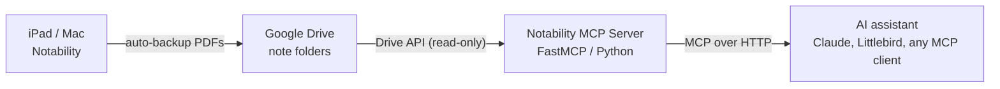

# Notability MCP Server

A custom MCP (Model Context Protocol) server that turns **Notability's Google Drive auto-backup** into a live, searchable knowledge base for AI assistants - readable from the cloud, even when the Mac it backs up from is shut off.

## Why

Notability auto-backs-up every note to Google Drive as a PDF - but that archive just sits there. This server makes it queryable:

- **`search_notes`** - full-text search across every note, served by Google Drive's server-side search. Zero PDFs downloaded, zero indexing infrastructure, works on a 512 MB container.
- **`read_note`** - extracts the text layer of any PDF (with retry + caching) and returns it to the assistant.
- **`list_notes` / `list_folders`** - recursive inventory of the backup tree with folder context, sizes, and modified times.

## Reliability engineering

Version 1 of this server did the obvious thing - download every PDF and search locally - and crashed: ~100 MB of PDFs against a 512 MB Railway container. Version 2.3 was rebuilt around constraints instead:

- **Search without downloading.** `search_notes` delegates to Google Drive's `fullText` API and filters matches against the known folder tree. The corpus is never pulled over the wire.
- **Bounded memory.** Downloaded note text lives in an LRU cache capped at 5 entries; eviction is logged.
- **Survives flaky networks.** Downloads retry 3 times with backoff and surface the real error instead of a silent empty string.
- **Handles messy Drive data.** Recursive tree walk tracks which folder each PDF belongs to, and duplicate folder names (a real quirk in live Drive data) are deduplicated.
- **Dual mode.** Runs against Google Drive, or against a local backup directory (`LOCAL_BACKUP_DIR`) with the same four tools - useful for development and for keeping everything on-device.

## Deployment

Runs anywhere Python runs; built for Railway-style containers (Dockerfile + Procfile included).

### Environment variables

| Variable | Required | Description |
|---|---|---|
| `GOOGLE_SERVICE_ACCOUNT_JSON` | Yes (Drive mode) | Full service-account key JSON, pasted as a string |
| `GOOGLE_DRIVE_FOLDER_ID` | No | ID of the Notability backup folder. If omitted, the server resolves a folder by name |
| `GOOGLE_DRIVE_FOLDER_NAME` | No | Folder name to resolve when no ID is given (default: `Notability`) |
| `LOCAL_BACKUP_DIR` | No | Set to run in local mode against a directory of PDFs instead of Drive |
| `PORT` | No | HTTP port (default: `8080`) |

### Google Drive setup

1. Enable Notability auto-backup to Google Drive (PDF format).
2. Create a Google Cloud service account with Drive API access (read-only scope).
3. Share the Notability backup folder with the service account email.
4. Deploy with the env vars above and point your MCP client at the URL.

The service account is read-only (`drive.readonly`); the server can list, search, and read, never modify.

## Tools

| Tool | Description |
|---|---|
| `list_folders()` | All backup folders, deduplicated |
| `list_notes(folder)` | Every PDF with folder, size, and modified time |
| `read_note(note_path)` | Full extracted text of a note (cached, retried) |
| `search_notes(query, max_results)` | Server-side full-text search across all notes |

## Stack

Python / FastMCP / Google Drive API (read-only service account) / pypdf / Railway (Docker)

## Limitations

Extraction uses the PDF text layer, so handwritten-only pages return empty text - the server says so honestly rather than guessing. (A vision-model extraction layer is the natural next step.)
